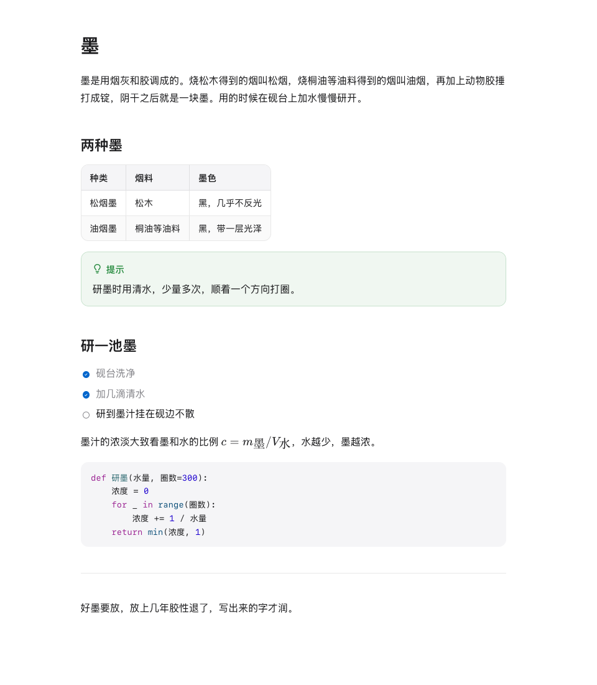
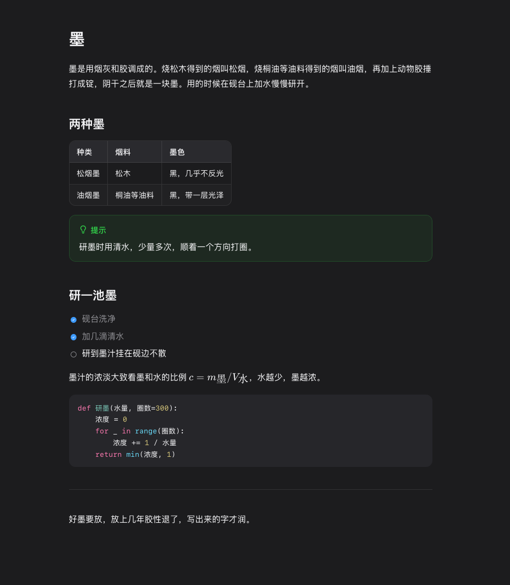

<p align="center"></p>

<h1 align="center">墨览</h1>

<p align="center">在访达里选中 Markdown 按空格，看到的就是排好版的样子。对中文格外友好。</p>

<p align="center">A Quick Look extension for Markdown on macOS, built with Chinese typography in mind. The interface is in Chinese.</p>

| 浅色 | 深色 |
|---|---|
|  |  |

## 能做什么

- **中文排版**：`**……。**后接汉字` 这类标准规则不认的粗体、斜体都能正确显示，中文软换行不留多余空格
- **内容齐全**：表格、代码高亮、公式、Mermaid 流程图、脚注、任务列表、`==高亮==`、`> [!NOTE]` 提示框、YAML 头都支持，全部离线
- **文档之间能跳**：相对链接、`[[维基链接]]` 和反引号里写的路径都能点；Markdown 在预览里打开，左上角可以返回，文件夹在访达打开
- **宽表格不挤**：撑到窗口宽度居中，还放不下就在框里横向滚动；放得下的表头吸顶
- **长文档也快**：标题多时右上角有目录，⌘F 查找，屏幕外的段落先不排版，几 MB 的文字稿也能很快打开
- **不联网**：页面只读本机文件，不加载任何外部资源
- **可以调**：主程序里能改外观、字号和版心宽度，也能直接打开或拖进 Markdown 来看
- **也能改**：主程序里有阅读、源码、双栏三种视图（⌘1 / ⌘2 / ⌘3），双栏左边改源码、右边实时预览，⌘S 写回原文件，保留原来的编码和换行，覆盖前自动留备份

## 安装

需要 Apple 芯片的 Mac、macOS 14 或更新版本、Xcode 命令行工具和 [Node.js](https://nodejs.org)，不需要完整的 Xcode。

```bash
xcode-select --install
git clone https://github.com/QuincyQiao/molan.git
cd molan
./重新构建.command
```

脚本会打包页面、跑自测、编译主程序和扩展，然后装到 `/Applications/墨览.app` 并注册快速查看扩展。

如果按空格没有变化，到「系统设置 → 通用 → 登录项与扩展 → 快速查看」勾上墨览。系统里同时开着别的 Markdown 预览扩展时，系统会随便挑一个，留一个就好。

想在桌面放一个替身：

```bash
MOLAN_DESKTOP_ALIAS=1 ./重新构建.command
```

## 开发

结构、调试方法和测试命令见[开发说明](说明.md)。

## 许可证

[MIT](LICENSE)，Copyright © 2026 Chenxu Qiao。用到的第三方库见 [THIRD-PARTY.md](THIRD-PARTY.md)。
